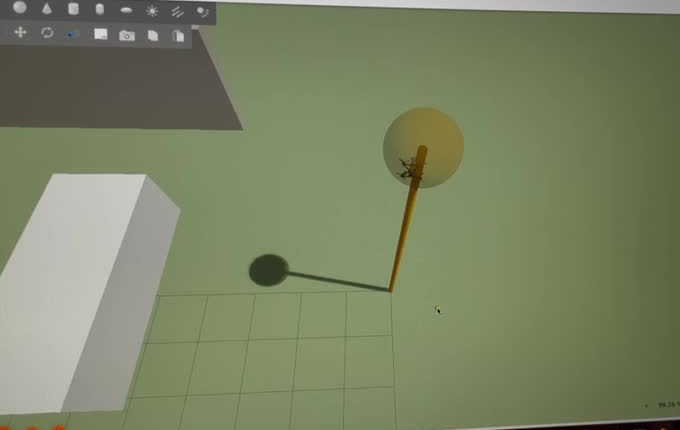
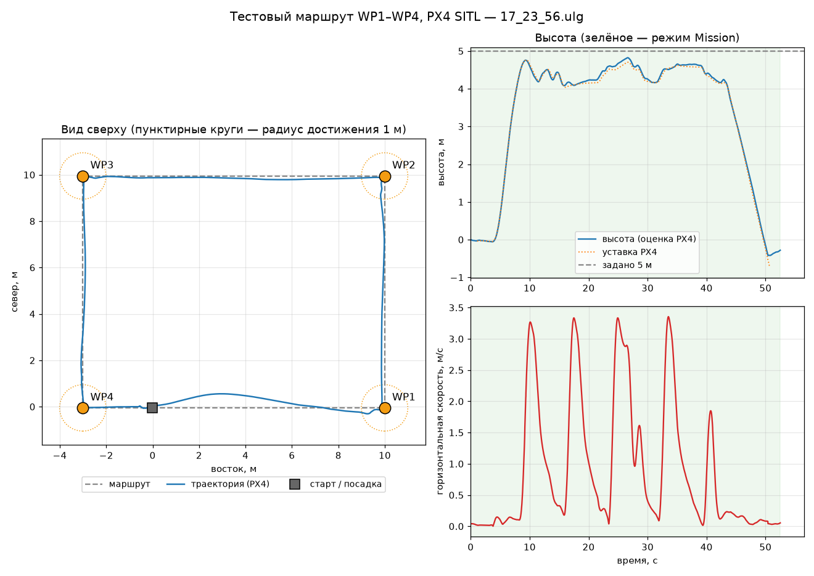
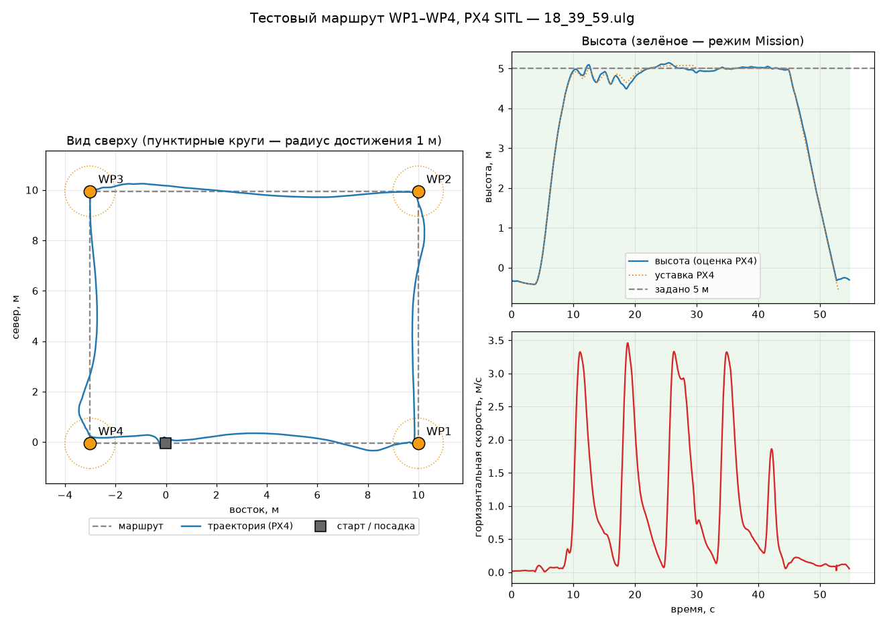

# Тестовый маршрут в симуляции — отчёт к 16 ноября

Группа моделирования: Кузнецова Марина, Крюков Константин
Модель project_quad v0.5, мир test_field, PX4 v1.17.0 SITL. Полёты — 14 ноября.

## Итог этапа

- Подготовлен тестовый маршрут по четырём точкам и скрипты: `tools/route.py`
  (точки), `tools/mission.py` (загрузка в PX4 и запуск), `tools/plot_mission.py`
  (траектория и точность по логу PX4).
- Маршрут выполнен в Gazebo в режиме Mission: взлёт, облёт WP1–WP4, возврат и
  посадка в точку старта. Промах по точкам — до 0,27 м, среднее отклонение от линии
  маршрута — 0,10–0,16 м.
- Найдено и устранено плавание высоты маршрута (4,1–4,8 м вместо 5 м): высота по GPS
  в симуляции отключена (`EKF2_GPS_CTRL = 5`), после этого 4,90 ± 0,19 м.

## Маршрут

Точки — оранжевые маркеры wp1…wp4 мира test_field. Координаты мира Gazebo:
X — восток, Y — север.

| № | Пункт | X, м | Y, м | Высота, м |
|---|---|---|---|---|
| 0 | взлёт | 0 | 0 | 5 |
| 1 | скорость 3 м/с | — | — | — |
| 2 | WP1 | 10 | 0 | 5 |
| 3 | WP2 | 10 | 10 | 5 |
| 4 | WP3 | −3 | 10 | 5 |
| 5 | WP4 | −3 | 0 | 5 |
| 6 | домой | 0 | 0 | 5 |
| 7 | посадка | 0 | 0 | 0 |

В каждой точке задержка 2 с, радиус достижения 1 м. Длина маршрута 46 м.
Координаты переводятся в широту и долготу от начала мира (55,7818° с.ш.,
37,7108° в.д.), маршрут загружается в PX4 по MAVLink (порт 14540).

Запуск — в README, раздел «Тестовый маршрут WP1–WP4».

## Полёт 1

Маршрут пройден полностью, точки — с промахом до 0,15 м. Но высота на маршруте
4,42 ± 0,21 м вместо 5 м. На графике видно, что дрон точно следует уставке PX4
(отставание до 0,17 м), а сама уставка гуляет от 4,1 до 4,8 м.

PX4 хранит высоту маршрута как «5 м над домашней точкой» в глобальных координатах
и пересчитывает её в локальные через оценку высоты, в которую подмешивается высота
по GPS. Шум GPS по высоте в Gazebo (0,4 м, независимые отсчёты) сдвигает эту оценку,
и уставка плывёт.

## Полёт 2 (высота только по барометру)

Высота по GPS отключена: `EKF2_GPS_CTRL` = 5 вместо 7 (в оценке высоты остаётся
барометр, координаты и скорость по GPS используются как раньше).

| Показатель | Полёт 1 | Полёт 2 |
|---|---|---|
| `EKF2_GPS_CTRL` | 7 (с высотой по GPS) | 5 (без неё) |
| Время маршрута | 52,5 с | 54,7 с |
| Промах по точкам WP1 / WP2 / WP3 / WP4 | 0,13 / 0,15 / 0,06 / 0,00 м | 0,16 / 0,12 / 0,08 / 0,27 м |
| Отклонение от линии маршрута: среднее / макс. | 0,10 / 0,61 м | 0,16 / 0,44 м |
| Уставка высоты PX4 (в среднем) | 4,38 м | 4,91 м |
| Высота на маршруте | 4,42 ± 0,21 м | 4,90 ± 0,19 м |
| Отставание высоты от уставки, макс. | 0,17 м | 0,18 м |
| Скорость на прямых участках | ≈ 3,3 м/с | ≈ 3,3 м/с |

Отклонение от линии маршрута по горизонтали в двух полётах разное (0,10 и 0,16 м в
среднем) — это разброс от полёта к полёту, а не следствие изменения настройки высоты.
Наибольшие отклонения — на выходе из точек, когда дрон разгоняется к следующей.

`EKF2_GPS_CTRL = 5` записан в настройки рамы для симуляции
(`px4/4050_gz_project_quad`, генерируется `tools/generate_model.py`).

## Открытые вопросы

| Вопрос | Кому |
|---|---|
| Нужны ли в маршруте другие действия (съёмка, зависание над точкой) для проверки CV | группа CV |

## Следующий этап (23 ноября)

Телеметрия и данные лидара из симуляции в ROS 2 (мост `ros/ros_gz_bridge.yaml`).
