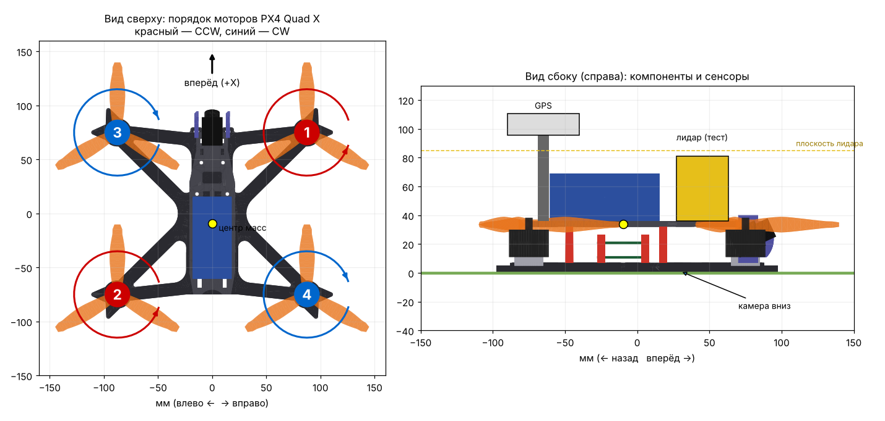

# Параметры физики и тестовые сенсоры — отчёт к 2 ноября

Группа моделирования: Кузнецова Марина, Крюков Константин
Модель project_quad v0.2, мир test_field v0.2

## Что сделано

1. Модель переведена на **CAD-геометрию конструкторов** (рама 5", диагональ 230,5 мм,
   меши из модели g4zo_x2_fpv5).
2. **Моторы перенумерованы под PX4 Quad X.** В CAD-модели был порядок Betaflight, с ним
   PX4 SITL не смог бы стабилизировать дрон.
3. В массу добавлены компоненты, которых нет в CAD: Pixhawk 6C Mini, GPS, радиомодем,
   бортовой компьютер, модуль питания, лидар. Масса выросла с 0,52 до **0,75 кг** (с Pixhawk 6C Mini, обновлено 6 ноября).
4. Пересчитаны центр масс и тензор инерции всей сборки.
5. Добавлены **тестовые сенсоры с шумами**: IMU, барометр, магнитометр, GPS, 2D-лидар,
   камера вниз. Имена сенсоров — как ожидает PX4 SITL.
6. В мире: магнитное поле Москвы, объекты для проверки камеры, заготовка ветра.
7. Скрипты проверки: `tools/check_sensors.sh` (все сенсоры) и `tools/motors.sh` (моторы).

## Параметры физики мира

| Параметр | Значение | Комментарий |
|---|---|---|
| Шаг интегрирования | 4 мс (250 Гц) | как в мирах PX4 SITL |
| Скорость симуляции | 1:1 к реальному времени | |
| Движок / столкновения | DART / ODE | по умолчанию Gazebo Harmonic |
| Гравитация | 9,80665 м/с² | |
| Атмосфера | адиабатическая | нужна барометру |
| Магнитное поле | ~52 мкТл, наклонение ~72°, склонение ~11° E | Gazebo считает по встроенной модели WMM из координат мира (как PX4); проверено: 16,4 / 3,3 / 49,8 мкТл (N / E / вниз) |
| Географическая привязка | 55,7818° с.ш., 37,7108° в.д., 150 м | условная, для GPS |
| Трение о землю | μ = 1,0 | |
| Ветер | выключен | блок в test_field.sdf, включается для проверок устойчивости |

## Параметры физики модели

| Параметр | Значение | Источник |
|---|---|---|
| Общая масса | **0,753 кг** | CAD (0,524) + оценки компонентов (0,229) |
| Центр масс | x = −9,5 мм, z = 34,2 мм | расчёт; смещён назад из-за аккумулятора |
| Ixx / Iyy / Izz | 1,87 / 2,82 / 2,59 ·10⁻³ кг·м² | CAD + теорема Штейнера |
| База моторов | 150 × 175 мм (диагональ 230,5) | отчёт конструкторов |
| Мотор / винт | AE2207 V2 1960KV / Gemfan 51499, 6S | модель конструкторов |
| Коэффициент тяги | 1,63·10⁻⁶ Н/(рад/с)² | 3200 рад/с → 16,7 Н (паспортная тяга) |
| Коэффициент момента | 0,016 | типовое |
| Макс. обороты | 3200 рад/с | |
| Постоянная времени мотора | 12,5 мс разгон / 25 мс торможение | типовое |
| Обороты висения | 1064 рад/с (33 % от макс.) | расчёт |
| Тяговооружённость | 9,0 | расчёт |

### Масса по компонентам

| Компонент | Масса, г | Статус |
|---|---|---|
| Рама, моторы, 4in1 ESC, VTX, приёмник, аккумулятор 6S 1250, FPV-камера | 444 | CAD конструкторов |
| 4 ротора (колокол + винт) | 80 | CAD конструкторов |
| Pixhawk 6C Mini | 39 | паспорт (53,3×39×16,2 мм) |
| Бортовой компьютер | 45 | **оценка, модель не выбрана** |
| Радиомодем SiK 433 МГц | 25 | оценка |
| Модуль питания и провода | 30 | оценка |
| GPS Holybro M9N + мачта | 40 | оценка |
| Лидар | 50 | **оценка, модель не выбрана** |
| **Итого** | **753** | |

## Тестовые сенсоры

| Сенсор | Имя в модели | Частота | Шум (СКО) | Реальное устройство |
|---|---|---|---|---|
| IMU | `imu_sensor` | 250 Гц | гироскоп 3,4·10⁻⁴ рад/с, акселерометр 0,004 м/с² + дрейф | IMU в Pixhawk 6C Mini |
| Барометр | `air_pressure_sensor` | 50 Гц | 1,5 Па (~0,12 м) | барометр в Pixhawk 6C Mini |
| Магнитометр | `magnetometer_sensor` | 100 Гц | 0,3 мкТл | компас в модуле M9N |
| GPS | `navsat_sensor` | 10 Гц | 0,7 м гориз. (в SDF задаётся в градусах: 6,3·10⁻⁶°), 1,2 м верт., 0,05 м/с | Holybro M9N |
| Лидар 2D | `lidar_sensor` | 10 Гц | 1 см; 360 лучей, 0,15–12 м | **не выбран, тестовый** |
| Камера вниз | `down_camera` | 15 Гц | 1280×720, угол 69° | для группы CV |
| FPV-камера | `fpv_camera` | 30 Гц | 640×480 | выключена по умолчанию |

Имена IMU, барометра, магнитометра и GPS совпадают с теми, что ожидает PX4 SITL, поэтому
к 9 ноября модель подключается к PX4 без переделок. Лидар и камеры публикуются в
короткие топики `/project_quad/lidar`, `/project_quad/camera_down/image`.

Лидар можно переключить в 3D-режим (16 лучей ±15°, до 30 м) параметром
`LIDAR_MODE = "3d"` в `tools/generate_model.py` — пригодится для 3D-картографирования.

## Проверка

Результат проверки 31 октября: все 6 сенсоров публикуют данные (IMU, барометр
101 326 Па, магнитометр, GPS, лидар 360 точек, камера 1280×720). Найдена и исправлена
ошибка: шум GPS в Gazebo задаётся в градусах, а не в метрах (было отклонение ~100 км).

1. Запуск мира: модель стоит на площадке, не проваливается.
2. `bash tools/check_sensors.sh` — все сенсоры, кроме выключенной FPV-камеры, OK.
3. `bash tools/motors.sh hover` — дрон почти висит (без стабилизации постепенно уплывает),
   `bash tools/motors.sh up` — взлетает, `bash tools/motors.sh stop` — падает.
4. Лидар: в Gazebo видны лучи вокруг дрона; при подлёте к стене расстояние уменьшается.
5. Камера вниз: в Gazebo меню ⋮ → Image Display → топик `/project_quad/camera_down/image`.

## Открытые вопросы к другим группам

| Вопрос | Кому | Почему важно |
|---|---|---|
| Модель, масса и габариты лидара | электронщики | сейчас тестовый лидар 50 г |
| Модель бортового компьютера | электронщики / программисты | масса, место |
| Pixhawk 6C Mini (53,3×39×16,2 мм): между ESC и верхней пластиной ~10 мм, по высоте не помещается | конструкторы, Гаджиева У. | нужно другое место или стойки выше |
| Место под GPS (мачта) и лидар на раме | конструкторы | в модели стоят условно |
| Порядок моторов: подключать по PX4 Quad X, не Betaflight | электронщики, конструкторы | MAIN OUT 1 = передний правый CCW и т.д. |
| Центр масс смещён на 9,5 мм назад | конструкторы | желательно сдвинуть аккумулятор вперёд |
| ~~Связка версий~~ | — | решено 6 ноября: Ubuntu 24.04 + ROS 2 Jazzy + Gazebo Harmonic, PX4 v1.17.0 |
| Камера: нужна ли и какая (вниз / FPV) | группа CV | параметры камеры в модели |

## Что будет к 9 ноября

Установка PX4 SITL и QGroundControl, подключение модели к PX4, взлёт и висение под
управлением автопилота. Для PX4 потребуется указать максимальные обороты моторов
(параметры `SIM_GZ_EC_MAX1…4` = 3200) — у этого дрона они выше, чем у стандартной модели PX4.
