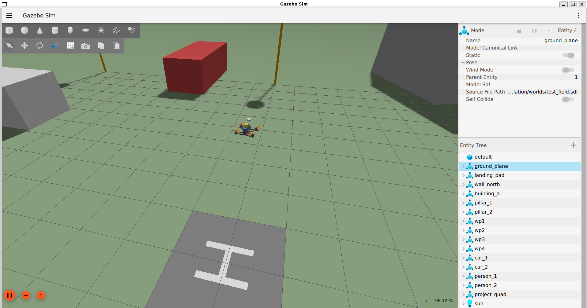
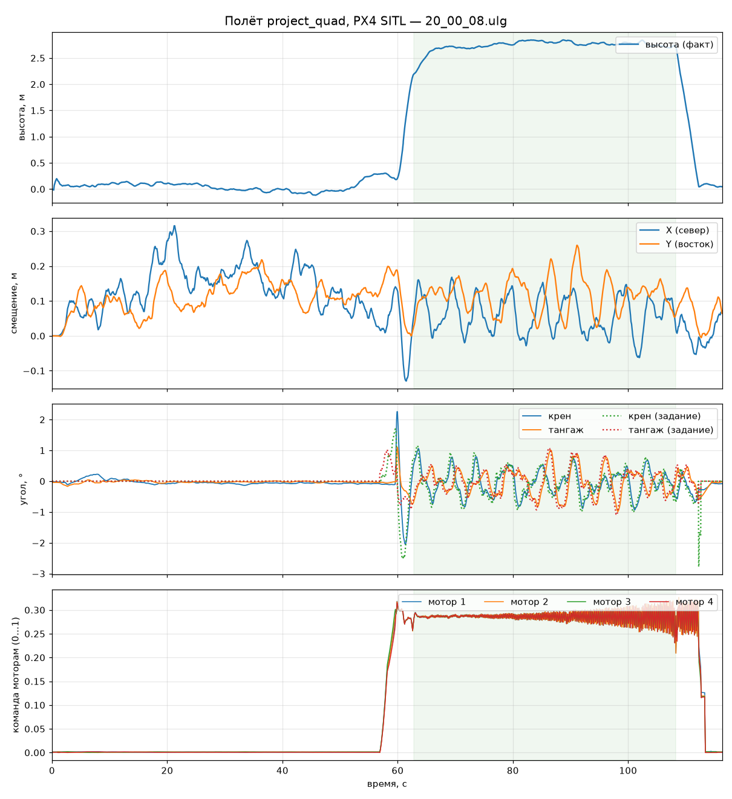

# Запуск модели и базовая стабилизация

Группа моделирования, этап 9 ноября 2026. Модель project_quad v0.4.1 (полёт — 8 ноября).

## Итог этапа

- Модель обновлена по компоновке конструкторов от 8.11: масса 0,773 кг, центр
  масс совпадает с центром тяги (обороты висения всех моторов одинаковые).
- Модель подготовлена к PX4 SITL v1.17.0: сделан airframe `4050_gz_project_quad`
  (геометрия роторов, выходы на моторы, тяга висения, коэффициенты регуляторов),
  скрипты установки и запуска.
- Найдено и исправлено ограничение PX4: команда мотору в Gazebo не больше 1000.
- Сделан запасной вариант стабилизации — встроенный регулятор Gazebo.
- Стабилизация проверена расчётом на Python (повторены регуляторы PX4 и Gazebo).
- **Полёт в Gazebo под управлением PX4 выполнен (8 ноября):** взлёт на 2,5 м,
  висение 45 с с разбросом высоты ±0,07 м, креном и тангажем до 1,1°, уходом
  по горизонтали до 0,24 м, посадка (п. 4).
- По результатам первого полёта уменьшен шум GPS в модели: с прежним шумом PX4
  неверно оценивал высоту на земле (ошибка до 1,85 м).

## 1. Модель по компоновке 8.11

| Компонент | Масса, г | Центр X; Y; Z, мм |
|---|---|---|
| Рама, моторы, регулятор, FPV-камера, VTX, приёмник | 244 | 0; 0; 11,8 |
| Роторы (4 шт.) | 80 | на моторах |
| Аккумулятор 6S 1250 | 220 | −24,0; 0; 52,5 |
| Pixhawk 6C Mini | 39,2 | 14,5; 0; 23,1 |
| Бортовой компьютер (оценка) | 45 | 40,0; 0; 16,0 |
| Радиомодем SiK 433 МГц | 25 | 60,0; 0; 20,0 |
| Модуль питания и провода | 30 | 0; 0; 12,0 |
| Мачта GPS + GPS M9N | 15 + 25 | 65,0; 0; 73,0 / 117,5 |
| Лидар (оценка) | 50 | −24,0; 0; 87,0 |
| **Итого** | **773** | ЦМ: X ≈ 0; Y = 0; Z = 35,2 |

Инерция части «без аккумулятора» взята из CAD-модели g4zo_x2 (минус аккумулятор
200 г). Проверка: получившийся центр масс по высоте — 11,8 мм, ровно как в
таблице конструкторов.

Инерция всего дрона: Ixx = 2,64·10⁻³, Iyy = 3,43·10⁻³, Izz = 3,68·10⁻³ кг·м².

## 2. Подготовка к PX4 SITL

PX4 подключается к уже запущенному Gazebo с нашим миром
(`PX4_GZ_STANDALONE=1`, `PX4_GZ_MODEL_NAME=project_quad`). Имена сенсоров и
топиков модели совпадают с теми, что ждёт PX4 (проверено по исходникам
`gz_bridge` PX4 v1.17.0).

**Ограничение команды моторам.** В PX4 v1.17 параметр `SIM_GZ_EC_MAX` ограничен
диапазоном 0…1000, а нашему дрону для висения нужно ≈ 1080 рад/с (план 2 ноября
предполагал `SIM_GZ_EC_MAX = 3200` — PX4 такое значение не примет). Решение:
обороты в модели масштабированы, 1000 условных = 3200 настоящих рад/с,
коэффициент тяги увеличен в 3,2² раза. Физика не меняется.

**Airframe 4050_gz_project_quad:**

| Параметр | Значение | Откуда |
|---|---|---|
| `CA_ROTOR0…3_PX / PY` | ±0,075 / ±0,0875 м | оси моторов из CAD (оси PX4: X вперёд, Y вправо) |
| `CA_ROTOR*_KM` | +0,05 (CCW), −0,05 (CW) | как у x500 |
| `SIM_GZ_EC_MIN / MAX` | 70 / 1000 | холостой ход ≈ 4% веса, как у x500 |
| `MPC_THR_HOVER` | 0,29 | обороты висения 337 из 1000 |
| `MC_ROLLRATE_K`, `MC_PITCHRATE_K` | 0,5 | расчёт устойчивости, см. п. 3 |
| `MC_YAWRATE_K` | 1,0 | стандартное |

## 3. Расчётная проверка стабилизации

Чтобы подобрать коэффициенты до полёта, на Python повторён каскад стабилизации
PX4: регулятор угла → регулятор угловой скорости (PID, D по отфильтрованному
гироскопу) → распределение по моторам с нормировкой как в PX4 → моторы с
запаздыванием (12,5 / 25 мс) → тяга ∝ ω² → вращение корпуса. Эталон — x500 из
PX4 с параметрами по умолчанию (он стабильно летает в PX4 SITL).

Ступенька по углу: крен 10°, тангаж 10°, рыскание 30° (`tools/analysis/px4_stability.py`):

| Вариант | Крен: до 90% / перерегулирование | Запас (раскачка при K ×) |
|---|---|---|
| x500, параметры PX4 по умолчанию | 260 мс / 0% | > 20 |
| project_quad, стандартные K = 1 | 312 мс / 0% | **2,5** |
| project_quad, K = 0,5 (наш airframe) | 296 мс / 0% | **5** |

Вывод: наш дрон лёгкий и с тяговооружённостью 8,8, поэтому со стандартными
коэффициентами запас устойчивости по крену всего 2,5 раза — шумы и задержки
симуляции могут его съесть. K = 0,5 удваивает запас без потери скорости реакции.
Рыскание со стандартными коэффициентами в норме (уменьшать его хуже —
перерегулирование растёт).

Встроенный стабилизатор Gazebo (`tools/analysis/gz_stabilizer.py`, регулятор
повторён по исходникам gz-sim 8): с наклоном 5° на старте выравнивается за
0,26 с, подъём на 2 м, висение с креном и тангажем < 0,01°.

Ограничения расчёта: нет шумов датчиков, ветра, оценки положения (EKF) и задержки
связи PX4 ↔ Gazebo. Это проверка порядка величин, финальная — полёт в Gazebo.

## 4. Полёт в Gazebo с PX4

Полёт выполнен 8 ноября на ноутбуке группы (Windows 11, WSL2, Ubuntu 24.04,
Gazebo Harmonic, PX4 v1.17.0 SITL). Сценарий: `commander takeoff` → висение →
`commander land`. Данные — из лога PX4, обработка `tools/plot_flight.py`.

*Рисунок — дрон в висении в Gazebo.*

### 4.1. Первый полёт

PX4 запустился, но не давал взлететь:

- `Preflight Fail: No connection to the GCS` — в airframe задан возврат домой при
  потере связи с наземной станцией (`NAV_DLL_ACT = 2`), а QGroundControl не был
  подключён. Для полёта без QGC: `param set NAV_DLL_ACT 0` (в airframe оставлено 2:
  это нужный failsafe для реального борта).
- `GPS Vertical Pos Drift too high`, `height estimate not stable` — PX4 не доверял
  высоте по GPS.

После `NAV_DLL_ACT 0` дрон взлетел и висел 3 минуты. Крен и тангаж — до 2,3°,
уход — до 0,35 м. Но ещё на земле PX4 считал высоту **1,85 м** вместо 0: дрон
поднялся на заданные 2,5 м, а в логе получилось 4,2 м ± 0,57 м
(`flight_19_41_59.png`).

**Причина** — шум GPS в модели: 0,7 м по горизонтали и 1,2 м по высоте, каждый отсчёт
независимый (белый шум, 10 Гц). Реальный GPS «плывёт» плавно, а такие скачки PX4
воспринимает как неисправность и неверно оценивает высоту. Шум уменьшен до
**0,3 м / 0,4 м** (`GPS_POS_NOISE_H_M`, `GPS_POS_NOISE_V` в `generate_model.py`).

### 4.2. Второй полёт (шум GPS уменьшен)

Предупреждений про GPS нет, на земле оценка высоты в пределах −0,1…+0,3 м.

| Показатель | Полёт 1 | Полёт 2 |
|---|---|---|
| Шум GPS гориз. / верт. | 0,7 / 1,2 м | 0,3 / 0,4 м |
| Высота на земле по оценке PX4 | 1,85 м | ≈ 0,25 м |
| Висение: высота, разброс | 4,19 ± 0,57 м | 2,75 ± 0,07 м |
| Макс. крен / тангаж | 2,3° / 2,1° | 1,1° / 1,0° |
| Уход по горизонтали | до 0,35 м | до 0,24 м |
| Газ на висении | ≈ 0,29 | ≈ 0,29 |

Высота 2,75 м — это заданные 2,5 м над точкой, где PX4 считал себя на старте
(+0,25 м). Газ на висении совпал с расчётным `MPC_THR_HOVER = 0,29`, то есть масса и
тяга в модели согласованы. Крен и тангаж следуют заданию PX4 без запаздывания и
перерегулирования.

### 4.3. Найденные проблемы

- **Дрожание команд моторам.** В обоих полётах через 15–30 с после взлёта команды
  моторам начинают быстро колебаться, размах растёт до ±0,06. На крен и тангаж это
  не влияет (< 1,1°), но так обычно выглядит слишком резкая реакция регулятора
  угловой скорости на шум гироскопа. Причина пока не установлена; варианты проверки:
  уменьшить `MC_ROLLRATE_D` / `MC_PITCHRATE_D`, понизить частоту среза фильтра
  гироскопа `IMU_GYRO_CUTOFF`, проверить, связано ли нарастание с разрядом батареи
  симулятора PX4.
- **Ошибка в `plot_flight.py`.** Если в логе есть записи раньше его начала, время
  становилось огромным (1,8·10¹³ с) — вычитание без знака. Исправлено.

## 5. Как воспроизвести

См. README: «Полёт с PX4» (основной) и «Полёт со стабилизатором Gazebo» (запасной).

## 6. Открытые вопросы

| Вопрос | Кому |
|---|---|
| Массы бортового компьютера и лидара (сейчас оценки 45 и 50 г) | электронщики, CV |
| Места в раме нет для компьютера, радиомодема и модуля питания (пересечения в CAD) — в модели стоят по таблице, после переноса пересчитать ЦМ | конструкторы |
| Подключение QGroundControl (Windows) к PX4 в WSL2 и миссия по WP1–WP4 | моделирование, Гаджиева У. (к 16 ноября) |
| Проверка `autopilot_bridge` программистов на PX4 SITL (Micro XRCE-DDS Agent) | моделирование + программисты |
| Подбор K по логам реального полёта в Gazebo; причина дрожания команд моторам | моделирование, Гаджиева У. |
