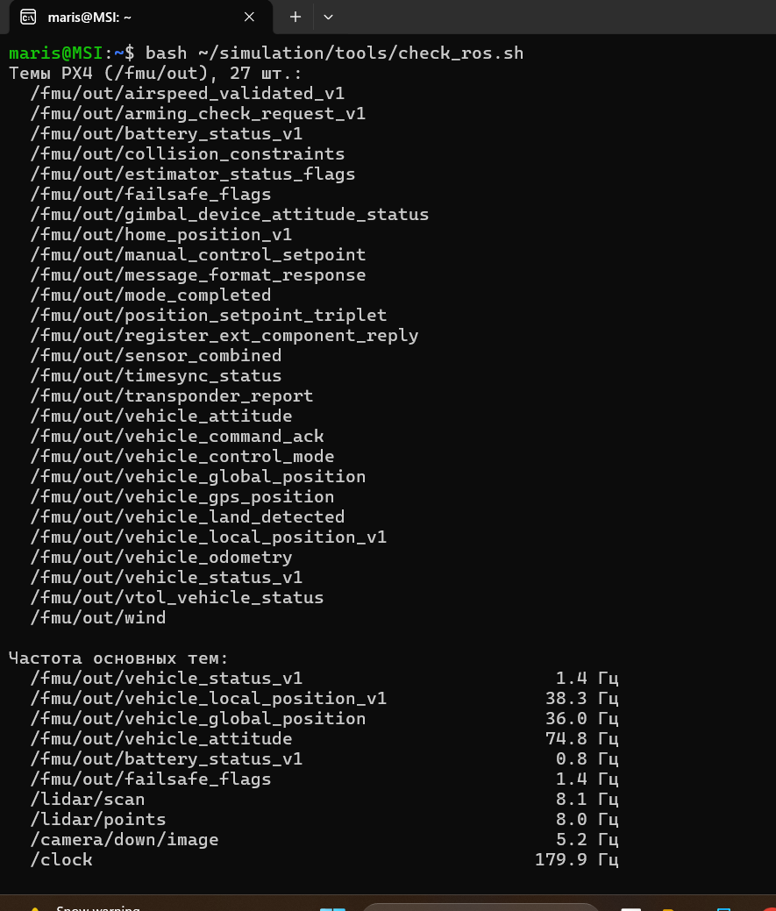
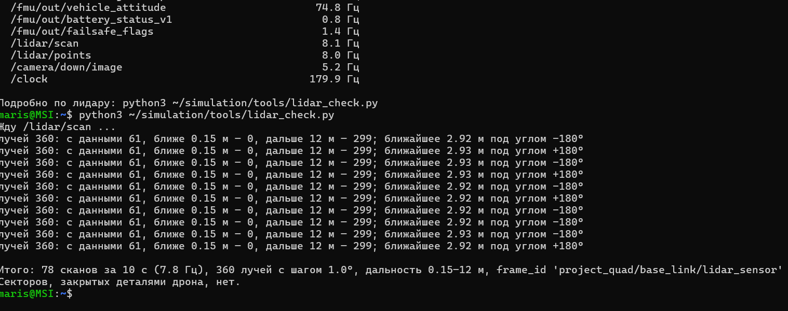
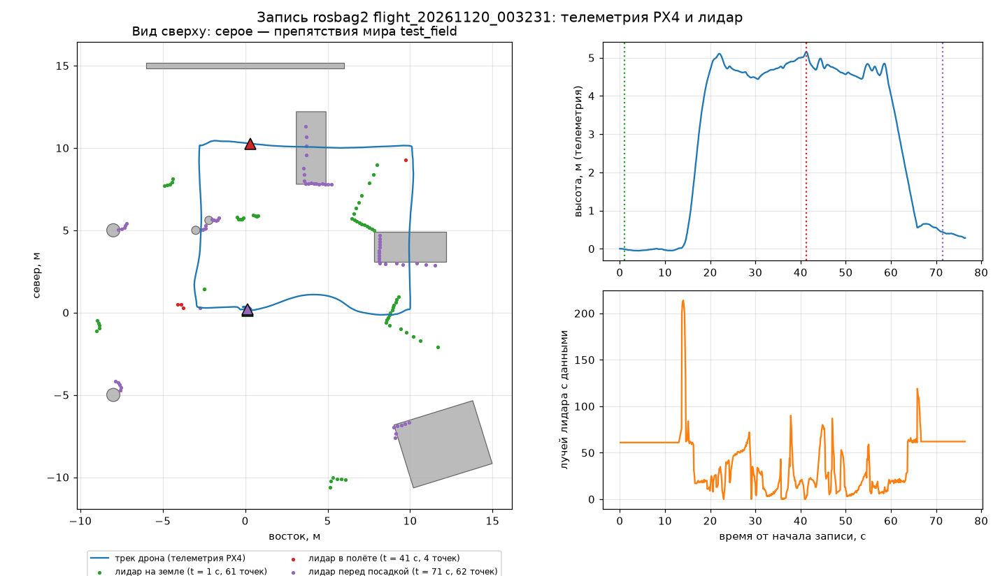
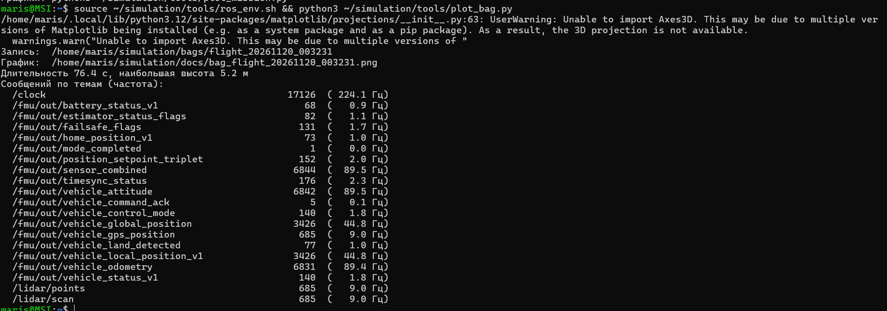
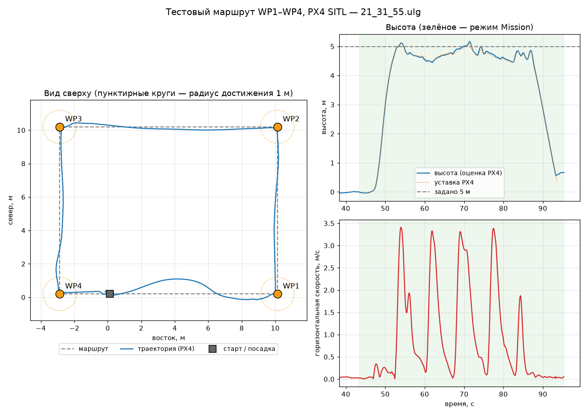

# Телеметрия и данные лидара в ROS 2 — отчёт к 23 ноября

Группа моделирования: Кузнецова Марина, Крюков Константин
Модель project_quad v0.6 (компоновка конструкторов от 16.11), PX4 v1.17.0 SITL,
ROS 2 Jazzy, Gazebo Harmonic. Проверка — 19–20 ноября на ноутбуке группы (WSL2).

## Итог этапа

- Телеметрия PX4 SITL передаётся в ROS 2 через Micro XRCE-DDS Agent v2.4.3:
  27 тем `/fmu/out/...`, пакет `px4_msgs` ветки `release/1.17`.
- Данные лидара и камеры передаются из Gazebo в ROS 2 мостом `ros_gz_bridge`:
  `/lidar/scan`, `/lidar/points`, `/camera/down/image`, `/camera/down/camera_info`, `/clock`.
- Записан полёт по тестовому маршруту в rosbag2 (MCAP): телеметрия, лидар и время
  симуляции — для отладки обработки лидара без симулятора.
- Модель обновлена по компоновке 16.11: масса 810 г, опоры 30 мм, лидар на кронштейне
  (плоскость 99,5 мм), компьютер и модем под основанием, камера вниз под основанием.

## Схема

```
Gazebo (модель, лидар, камера) ──gz-transport──> ros_gz_bridge ──> /lidar/*, /camera/down/*, /clock
        │ датчики IMU, GPS, барометр, магнитометр
        v
PX4 SITL v1.17.0 ──uXRCE-DDS, UDP 8888──> Micro XRCE-DDS Agent ──> /fmu/out/...
```

Запуск: `tools/ros_run.sh` (оба моста), проверка: `tools/check_ros.sh`,
`tools/lidar_check.py`, запись: `tools/record.sh`, картинка по записи: `tools/plot_bag.py`.
Установка: `tools/install_ros.sh`. Подробно — README, «Телеметрия и лидар в ROS 2».

## Темы и частоты (дрон на земле)



| Тема | Тип | Частота |
|---|---|---|
| `/fmu/out/vehicle_status_v1` | `px4_msgs/VehicleStatus` | 1,4 Гц |
| `/fmu/out/vehicle_local_position_v1` | `px4_msgs/VehicleLocalPosition` | 38 Гц |
| `/fmu/out/vehicle_global_position` | `px4_msgs/VehicleGlobalPosition` | 36 Гц |
| `/fmu/out/vehicle_attitude` | `px4_msgs/VehicleAttitude` | 75 Гц |
| `/fmu/out/battery_status_v1` | `px4_msgs/BatteryStatus` | 0,8 Гц |
| `/fmu/out/failsafe_flags` | `px4_msgs/FailsafeFlags` | 1,4 Гц |
| `/lidar/scan` | `sensor_msgs/LaserScan` | 8 Гц |
| `/lidar/points` | `sensor_msgs/PointCloud2` | 8 Гц |
| `/camera/down/image` | `sensor_msgs/Image`, 1280×720 | 5 Гц |
| `/clock` | `rosgraph_msgs/Clock` | 180 Гц |

У части тем PX4 v1.17.0 есть суффикс `_v1`: `vehicle_status_v1`, `vehicle_local_position_v1`,
`battery_status_v1`, `home_position_v1`, `airspeed_validated_v1`, `arming_check_request_v1`.

Лидар (8–9 Гц вместо 10) и камера (5 кадров/с вместо 15) работают медленнее заданного:
изображение для них рисуется на видеокарте ноутбука через WSL2, и её не хватает на всё.

## Лидар



360 лучей с шагом 1°, дальность 0,15–12 м, `frame_id` = `project_quad/base_link/lidar_sensor`
(начало — центр лидара, X вперёд, Y влево).

- Лидар видит и маркеры маршрута WP1–WP4 (у них нет коллизии, пролететь сквозь них можно):
  лидар в Gazebo работает по изображению. Ближайшее «препятствие» на старте — маркер WP4
  в 2,9 м позади.
- Мачта GPS (в 9 см от лидара, ближе минимальной дальности 0,15 м) в симуляции сектор
  не закрывает: Gazebo не рисует объекты ближе минимальной дальности. На настоящем дроне
  в секторе около 6° прямо по курсу данных не будет.

## Запись полёта

Маршрут WP1–WP4 (`tools/mission.py`), запись `tools/record.sh`, 76 с, 9,9 МБ.





- Точки лидара в полёте и после посадки ложатся на препятствия мира (машины, колонны,
  «люди», здание) — данные лидара и положение по телеметрии согласованы.
- Точки до взлёта (зелёные) развёрнуты примерно на 30° относительно препятствий.
  Вероятно, курс PX4 на земле ещё не установился и уточнился в полёте. Проверить по
  логу PX4 (`estimator_status_flags`).
- На взлёте число лучей с данными подскакивает до 200: лидар наклоняется вместе с дроном
  и лучи попадают в землю. Обработке нужно учитывать крен и тангаж
  (`/fmu/out/vehicle_attitude`).
- На высоте 5 м лидар видит лишь несколько точек: большинство препятствий ниже
  плоскости сканирования.

## Маршрут с новой моделью



52 с, промах по точкам 0,11–0,14 м, отклонение от линии маршрута в среднем 0,13 м
(наибольшее 0,89 м на первом отрезке после взлёта). Высота 4,72 ± 0,19 м, уставка PX4 4,71 м:
дрон следует уставке, а сама уставка ниже 5 м на 0,3 м, хотя `EKF2_GPS_CTRL = 5`
применён (проверено `param show`). Причину ищем по логу PX4 на следующем этапе.

## Найденные и исправленные ошибки

| Проблема | Причина | Исправление |
|---|---|---|
| Темы лидара не видны в `ros2 topic list` | служебный `ros2 daemon` помнил старый список | `check_ros.sh` и `record.sh` перезапускают daemon |
| Маршрут сразу заканчивался посадкой | PX4 помнит пункт прошлой миссии, при загрузке того же маршрута продолжает с него | `mission.py` ставит текущим пункт 0; сообщает, если дрон не взлетел |
| Дрон с опорами не взлетал на 80 % газа | высота появления в мире (0,012 м) не учитывала опоры, они ушли в площадку | высота появления считается из `LEG_HEIGHT` |

## Для других групп

- **Программистам:** темы `/fmu/out/...` с суффиксами — выше; запись rosbag2 для отладки
  обработки лидара; маркеры маршрута видны лидару; лидар наклоняется вместе с дроном.
- **Группе CV:** камера вниз есть — `/camera/down/image` (1280×720, угол 69°, в симуляции
  около 5 кадров/с) и `/camera/down/camera_info`; стоит под основанием, закреплена жёстко.
